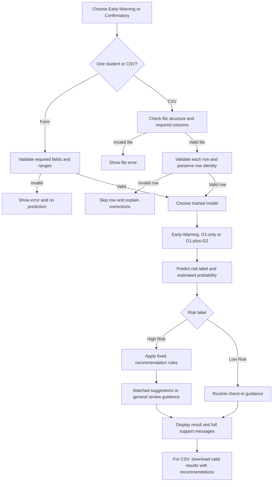

# Current project workflow

Reviewed for issue #70 on 20 October 2026 against `6bc1c18`.
The dashboard, prediction code and recommendation function are connected.

## Input and output rules

- Early-Warning uses attendance estimate, estimated study hours and previous
  failures, with no grades. Confirmatory requires G1 and accepts optional G2.
- Blank G2 selects the G1-only model; zero is a supplied grade and selects G1+G2.
  Previous score is G1 × 5 or the G1/G2 average × 5. G3 is not an input.
- Attendance must be 0–100; study hours 0–40; failures a whole number 0–3;
  supplied grades 0–20. Invalid form input produces an error. Invalid CSV rows
  are skipped while valid rows continue. Empty/malformed files and missing
  required columns produce file errors; all-invalid files produce no predictions.
- Duplicate student IDs retain separate row identities. Skipped rows receive
  no prediction or recommendation. Dashboard reasons explain corrections.
- The screen shows probability as a percentage; the CSV keeps its decimal value.
  Full suggestions appear below the CSV table and remain in the downloaded CSV.
- Changing form inputs or mode clears stale form results. The result is a support
  tool for human review, not a decision about the student.

## Subsystems and evidence

| Part | Implementation | Checks |
|---|---|---|
| Interface and upload handling | [dashboard.py](../code/dashboard.py) | [Dashboard tests](../code/test_dashboard.py), S6-01–S6-16 and S6-21–S6-24 |
| Input preparation and prediction | [data_processing.py](../code/data_processing.py), [predict.py](../code/predict.py), saved models | [Input tests](../code/test_data_processing.py), [prediction tests](../code/test_predict.py), S6-02–S6-15 |
| Support rules | [recommend.py](../code/recommend.py), [agreed rules](recommendation-rules.md) | [Rule tests](../code/test_recommend.py), S6-17–S6-18 |
| Complete dashboard performance | Form and CSV workflows above | S6-19–S6-20 on the agreed reference Mac |

The [Sprint 6 review](sprint6-review.md) links the actual platform, timing and
usability evidence, including unmet targets. The [model evaluation](evaluation_report.md)
is a separate historical baseline. Suggestions use fixed rules; they neither
change model predictions nor prove that an input caused the predicted risk.

[Deployment, maintenance, user guide and demo video](sprint7-planning.md) are
Phase E work. Current operation is local Streamlit use, not a hosted service.
