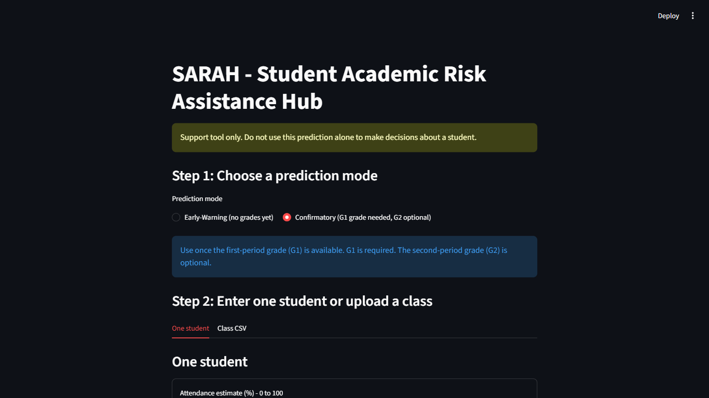
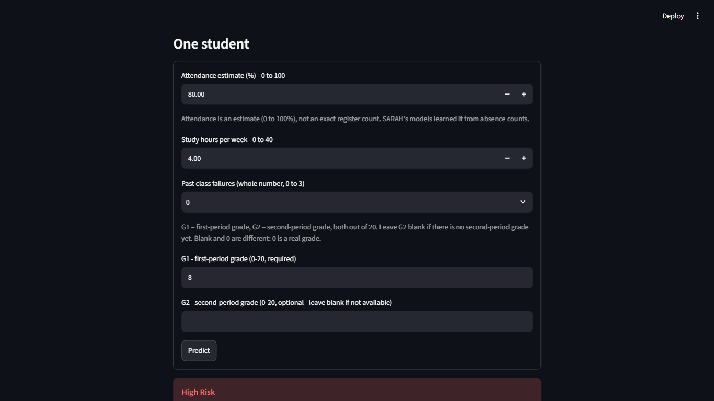
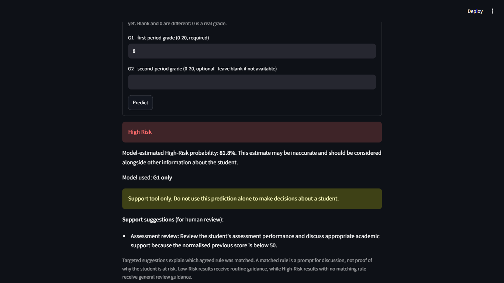
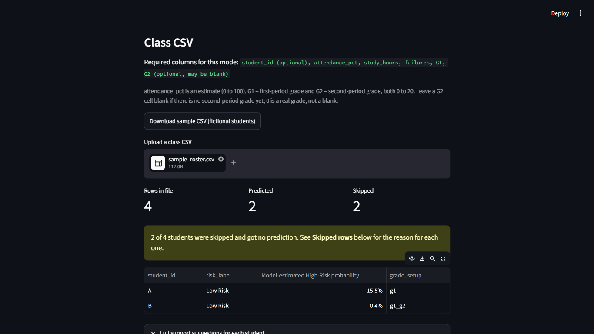
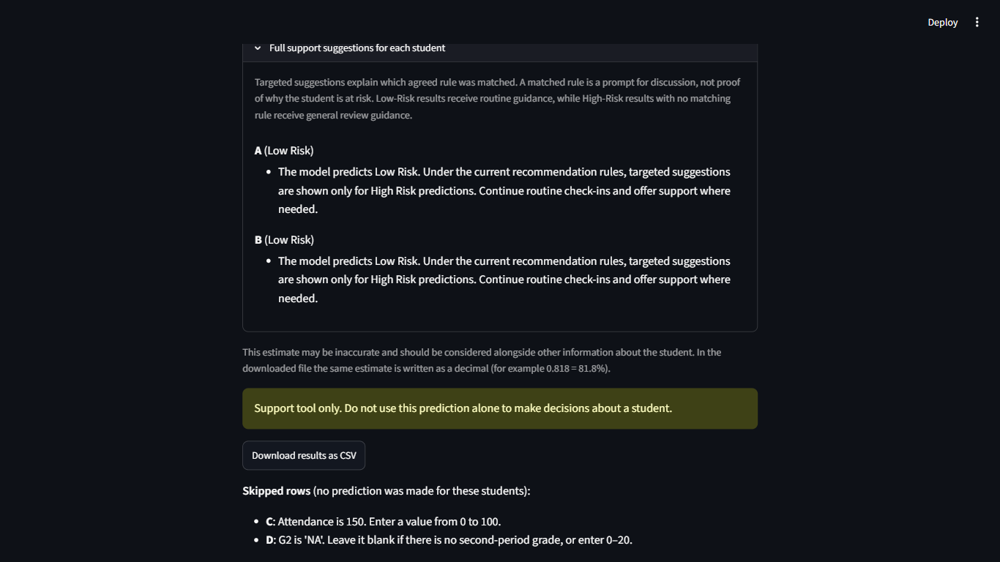

# SARAH user guide

This guide is for a tutor or student tester using the SARAH dashboard for the first time.
It explains how to make a prediction for one student or a whole class, and how to read
the results. No programming knowledge is needed after setup.

Screenshots in this guide show the dashboard at commit `fe9685a` (20 October 2026),
on Windows in Microsoft Edge at 1366 × 768, using fictional students only.
They predate the #80 study-hours warning and the `input_warning` CSV column.
The updated behaviour is described below; those screenshots are historical.

## Contents

1. [What SARAH does, and what it does not do](#1-what-sarah-does-and-what-it-does-not-do)
2. [Start and stop SARAH](#2-start-and-stop-sarah)
3. [The screen at a glance](#3-the-screen-at-a-glance)
4. [Step 1: choose a prediction mode](#4-step-1-choose-a-prediction-mode)
5. [Your first prediction: one student](#5-your-first-prediction-one-student)
6. [How to read the result](#6-how-to-read-the-result)
7. [A whole class: upload a CSV file](#7-a-whole-class-upload-a-csv-file)
8. [When something goes wrong](#8-when-something-goes-wrong)
9. [Limitations](#9-limitations)
10. [Reproducing the results](#10-reproducing-the-results)
11. [Study-hours input warning and limitation](#11-study-hours-input-warning-and-limitation)

## 1. What SARAH does, and what it does not do

SARAH (Student Academic Risk Assistance Hub) estimates whether a student may be at
**High Risk** or **Low Risk** of academic difficulty. It uses attendance, study hours,
past class failures and, when available, the student's first- and second-period grades.
For High-Risk results it suggests support ideas for a tutor to discuss.

SARAH is a **support tool only**. It does not make decisions about students, and its
predictions can be wrong. Always combine a result with what you know about the student.

**Use fictional or properly authorised data only.** Do not enter real students' details
unless your institution has approved it.

## 2. Start and stop SARAH

SARAH runs on your own computer and opens in your web browser. It needs to be set up
once: follow the [local deployment guide](deployment-guide.md) for Windows or macOS.
It also lists what to do if setup does not work.

**To start SARAH**, open PowerShell (Windows) or Terminal (macOS) in the repository root
folder and run:

```powershell
.venv\Scripts\python.exe -m streamlit run project/code/dashboard.py
```

On macOS use `.venv/bin/python` instead of `.venv\Scripts\python.exe`.

SARAH opens in your browser at **http://localhost:8501**. If the browser does not open
by itself, copy the "Local URL" shown in the terminal into your browser.

**Keep the terminal window open** while you use SARAH. **To stop SARAH**, click the
terminal window and press **Ctrl + C** (**Control + C** on macOS), or close it.

## 3. The screen at a glance



From top to bottom:

- **Support notice** (yellow): "Support tool only. Do not use this prediction alone to make
  decisions about a student."
- **Step 1: Choose a prediction mode**, with a short explanation of the chosen mode (blue box).
- **Step 2: Enter one student or upload a class**, with two tabs:
  - **One student**: type in one student's details.
  - **Class CSV**: upload a file with many students.

## 4. Step 1: choose a prediction mode

Choose the mode that matches the information you have **right now**.

| Mode | Use it when | Information needed |
|---|---|---|
| **Early-Warning (no grades yet)** | Early in the course, before any grades exist | Attendance, study hours, past class failures |
| **Confirmatory (G1 grade needed, G2 optional)** | After the first-period grade is available | The same three, plus **G1**; **G2** if you have it |

**G1** is the first-period grade and **G2** is the second-period grade. Both are marks
**out of 20** (not percentages).

**Blank G2 and 0 are different:**

- Leave **G2 blank** if there is no second-period grade yet. SARAH then uses its
  "G1 only" model.
- Enter **0** only if the student really scored 0. SARAH then uses its "G1 + G2" model
  with a mark of 0.

Early-Warning does **not** mean the student is safe. Both modes can give High Risk or
Low Risk. In our reserved test set, the Confirmatory models identified more High-Risk
students than Early-Warning. This does not guarantee better predictions for another
course or institution (see [Limitations](#9-limitations)).

## 5. Your first prediction: one student



1. In **Step 1**, choose a mode (for this example, **Confirmatory**).
2. In **Step 2**, make sure the **One student** tab is selected.
3. Fill in the boxes:

   | Box | What to enter | Allowed values |
   |---|---|---|
   | Attendance estimate (%) | Roughly how much of the class time the student attends | 0 to 100 |
   | Study hours per week | Estimated hours of study per week | 0 to 40 |
   | Past class failures | Number of classes failed before (choose from the list) | 0, 1, 2 or 3 |
   | G1 (Confirmatory only) | First-period grade | 0 to 20, required |
   | G2 (Confirmatory only) | Second-period grade | 0 to 20, or leave blank |

4. Click **Predict**.

**Example to try:** Confirmatory, attendance **80**, study hours **4**, failures **0**,
G1 **8**, G2 blank. SARAH shows **High Risk** with a model-estimated probability of
**81.8%** and uses the **G1 only** model.

(An Early-Warning example: attendance **40**, study hours **4**, failures **0** gives
**High Risk**, **85.9%**, with an attendance support suggestion.)

**About the attendance number:** it is an **estimate**, not an exact register count.
Use fictional attendance estimates when trying this prototype. The training input was
calculated from absence counts, so it is not equivalent to a measured attendance
percentage. Using real attendance data would require further review.

If you change any box or the mode after predicting, the old result disappears. Click
**Predict** again to get a new one.

If a value is not allowed, SARAH shows a red message starting "Please fix the input"
(for example, "attendance_pct must be 0 to 100") and makes no prediction. Correct the
value and click **Predict** again.

## 6. How to read the result



### Risk label

**High Risk** (red box) or **Low Risk** (green box). In the original data, "High Risk"
meant the student's final grade was below 10 out of 20.

### Model-estimated High-Risk probability

For example: "Model-estimated High-Risk probability: **81.8%**. This estimate may be
inaccurate and should be considered alongside other information about the student."

What this number means:

- It is **the model's estimate**, based on patterns in past students' data. It is **not**
  the student's mark, and it is **not** a measured or guaranteed chance.
- A higher number means the model is more confident the student belongs in the High-Risk
  group. Around 50% or above usually means a High Risk label.
- **The estimate can be wrong in both directions.** When the models were tested on 79
  students they had not seen before (26 of them truly High Risk):
  - Early-Warning found 11 of the 26, and 14 of the students it flagged were not High Risk.
  - Confirmatory with G1 only found 20 of the 26, with 8 false alarms.
  - Confirmatory with G1 and G2 found 23 of the 26, with 5 false alarms.

  So some at-risk students are missed, and some students are flagged who are fine.
  See the [evaluation report](evaluation_report.md) for details.

### Model used (Confirmatory only)

"G1 only" when G2 was left blank, or "G1 + G2" when both grades were entered.

### Support suggestions

Suggestions are **prompts for a conversation**, not proof of why a student is at risk,
and they are not guaranteed to help.

- **High Risk:** SARAH shows a targeted suggestion for each agreed rule the student meets:

  | Rule | Suggestion |
  |---|---|
  | Attendance 60% or below | Attendance support |
  | Study hours 1.5 per week or below | Study planning |
  | 1 or more past failures | Previous-failure support |
  | Confirmatory only: G1 (or the average of G1 and G2) below 10 out of 20 | Assessment review |

  If a High-Risk student meets none of these rules, SARAH asks a staff member to review
  the student's circumstances.
- **Low Risk:** SARAH gives routine guidance only: continue routine check-ins and offer
  support where needed.

The rules are the team-approved [recommendation rules](recommendation-rules.md).

### Human review

The yellow notice repeats with every result: **do not use the prediction alone** to make
decisions about a student. A tutor should consider attendance records, recent work,
personal circumstances and conversations with the student.

## 7. A whole class: upload a CSV file

### Prepare the file

Use a spreadsheet (for example Excel) and **Save As → CSV UTF-8 (Comma delimited) (*.csv)**.
The first row must contain the column names.

| Column | Needed? | Allowed values |
|---|---|---|
| `student_id` | Optional (recommended) | Any label, e.g. A, B, S001. Use fictional IDs. |
| `attendance_pct` | Required | 0 to 100 |
| `study_hours` | Required | 0 to 40 |
| `failures` | Required | Whole number 0 to 3 |
| `G1` | Required in Confirmatory | 0 to 20 |
| `G2` | Optional | 0 to 20, or leave the cell **blank** |

Example (`project/data/sample_roster.csv`, fictional students):

```text
student_id,attendance_pct,study_hours,failures,G1,G2
A,60,4,1,12,
B,80,6,0,12,14
C,150,5,0,12,14
D,80,5,0,12,NA
```

Column names are matched ignoring capital letters and extra spaces, so ` g1 ` works as
`G1`. In Early-Warning mode, `G1` and `G2` columns are ignored if present.

To get a ready-made example, click **Download sample CSV (fictional students)** in the
Class CSV tab.

### Upload and read the results



1. In **Step 1**, choose the mode (for the sample file, **Confirmatory**).
2. Click the **Class CSV** tab.
3. Under **Upload a class CSV**, click the upload box (or drag your file onto it) and choose your file.
4. Check the three counts: **Rows in file**, **Predicted** and **Skipped**. Predicted plus
   Skipped should equal Rows in file.
5. If any students were skipped, a yellow warning says how many, for example
   "2 of 4 students were skipped and got no prediction".
6. The table shows each predicted student's risk label, model-estimated probability and,
   in Confirmatory mode, which grade setup was used (`g1` or `g1_g2`).
7. Open **Full support suggestions for each student** to read every suggestion in full.
   (It opens automatically for 30 students or fewer.)



For study hours above 12, valid predictions carry an input warning. Read the full
warning above the table and check which students it applies to. It is separate
from skipped rows and support suggestions.

### Download the results

Click **Download results as CSV** to save `sarah_predictions.csv`. It contains only the
predicted students, with their recommendations and `input_warning` values. In the downloaded file the probability is
written as a decimal: **0.818 means 81.8%**. Skipped students are not in the download.

### Skipped rows: why and how to fix them

A student with a problem in their row is **skipped** (no prediction). All the other
students are still predicted. Each skipped student is listed under **Skipped rows** with
the problem and how to fix it, for example:

| Message | What to do |
|---|---|
| Attendance is 150. Enter a value from 0 to 100. | Correct the attendance value |
| G2 is 'NA'. Leave it blank if there is no second-period grade, or enter 0–20. | Delete "NA" so the cell is empty, or enter the real grade |
| G1 is missing. Enter the first-period grade from 0 to 20. | Add the G1 grade (needed in Confirmatory mode) |
| Past class failures is 1.5. Enter a whole number from 0 to 3. | Use a whole number |
| has 7 values but the header has 6 columns (check for a missing or extra comma) | Fix the extra or missing comma in that row |

If a row has several problems, all of them are listed. Fix the file in your spreadsheet,
save it as CSV again and upload it again.

### Student IDs

- **Without a `student_id` column**, students are labelled by their row number
  ("row 1", "row 2"…), counting the rows after the header.
- **Two students with the same ID** are both kept and predicted separately, so check
  your IDs are unique to avoid mixing them up.

### Starting again

- To use another file, click the **✕** next to the file name, then upload the new file.
- If you change the mode in Step 1, SARAH recalculates the same file in the new mode.
  Check the counts and the "Required columns" line again.

## 8. When something goes wrong

**Messages that stop the whole file** (no students are predicted):

| Message | Fix |
|---|---|
| This file cannot be processed: The CSV contains no students. | The file is empty or has only the header row. Add students. |
| This file cannot be processed: Missing required columns: G1 | Add the missing column, or switch to Early-Warning if you have no grades |
| This file cannot be processed: Column(s) appear more than once: G1 | Remove the duplicate column |
| This file cannot be processed: The file has an unmatched quote mark (") … | Remove the stray " in the spreadsheet, save as CSV again and upload again |
| This file cannot be read. Please save it as a UTF-8 CSV and upload again. | Save As **CSV UTF-8** and upload again |
| No valid students to process. See the skipped rows below. | Every row had a problem; fix the rows listed under Skipped rows |

**Other problems:**

| Problem | What to do |
|---|---|
| The browser did not open | Go to the "Local URL" shown in the terminal, usually http://localhost:8501 |
| The address shows 8502 instead of 8501 | Another copy of SARAH is still running. Close the old terminal window and start again |
| The page stopped responding | Check the terminal window is still open; if it was closed, start SARAH again |
| A red "Please fix the input" message | Correct the value shown and click Predict again |

## 9. Limitations

- **Predictions can be wrong.** In our reserved test set, the Confirmatory models identified
  more High-Risk students than Early-Warning (see the figures in [section 6](#6-how-to-read-the-result)).
  This does not guarantee better predictions for another course or institution.
  SARAH does not promise accuracy for any student.
- **The data is limited.** The models learned from 395 students in a mathematics course
  at two Portuguese schools (UCI Student Performance dataset). Results may not carry over
  to other courses, institutions or countries.
- **Inputs are approximate.** Attendance is an estimate converted from absence counts, and
  study hours come from broad categories in the original data.
- **Study hours above 12 receive a warning.** They go beyond the highest value used in the
  training-data conversion, so those predictions may be unreliable
  (see [section 11](#11-study-hours-input-warning-and-limitation)).
- **Suggestions are not proven interventions.** They come from simple agreed rules and
  do not explain the cause of a result or guarantee improvement.
- **Testing so far is small.** Usability was checked with one tester; see the
  [Sprint 6 review](sprint6-review.md) for the recorded results and limitations.

Always use SARAH alongside human judgement and other information about the student.

## 10. Reproducing the results

This section is for a lecturer or developer who wants to check how the models were built.
Normal use of the dashboard does not need any of these steps: the trained models are
already included.

| Topic | Summary | Where to find details |
|---|---|---|
| Dataset | UCI Student Performance dataset, mathematics course (`student-mat.csv`, 395 students), Cortez and Silva (2008), [doi.org/10.24432/C5TG7T](https://doi.org/10.24432/C5TG7T). Stored at `project/data/student-mat.csv`. `project/code/verify_dataset.py` checks it has 395 students: 130 High Risk and 265 Low Risk. | [Project README](../README.md#set-up-from-the-repository-root) |
| Preprocessing | High Risk means final grade G3 below 10 out of 20. Inputs: attendance estimate from absences (capped at 30), study hours from the study-time category, past failures and, in Confirmatory mode, a previous score from G1 or the average of G1 and G2. G3 is never used as an input. | [`data_processing.py`](../code/data_processing.py), [feature selection](../../assignment/docs/feature_selection.md), [mode guide](mode-guide.md) |
| Data split and validation | 79 students (20%, stratified, random seed 42) are reserved as the test set before any model selection. The other 316 development students are used for five-fold stratified cross-validation of 12 combinations (3 setups × Logistic Regression or Decision Tree × 2 class-weight settings), chosen by High-Risk recall. The reserved students are used once, at the end. | [Evaluation report](evaluation_report.md), [`train_models.py`](../code/train_models.py) |
| Software versions | Python 3.11 or newer. Packages are listed in `project/code/requirements.txt`; scikit-learn is pinned to 1.8.0 because the saved models were created with it. Run `pip freeze` to record the exact versions you used. | [`requirements.txt`](../code/requirements.txt), [deployment guide](deployment-guide.md) |
| Training and comparison commands | `project/code/train_models.py` retrains the three models; `project/code/issue33_comparison.py --overwrite` refreshes the comparison outputs. Run them from the repository root with the `.venv` Python. | [Working with the models](../README.md#working-with-the-models), [mode guide](mode-guide.md#repeat-training-and-evaluation) |
| Expected outputs | Training writes the models, `selected_mode.txt` and `feature_stats.json` to `project/models/`, `project/docs/evaluation_report.md`, and the confusion matrices in `project/docs/figures/`. The comparison script writes its CSV files, `run_details.txt` and the [comparison report](issue33_report.md) in `project/docs/`, and its chart in `project/docs/figures/`. | [Project README](../README.md#working-with-the-models) |

**Warning: retraining overwrites the generated files** listed above, including the saved
models used by the dashboard. Work on a separate copy or branch, and compare the new
evaluation report with the committed one before replacing anything. The submitted
assignment files in `assignment/` are not changed by these commands.

## 11. Study-hours input warning and limitation

The accepted range remains 0–40. Values above 12 receive an input warning because
training categories were converted to 1.5, 3.5, 7.5 and 12 hours. Twelve is an
assumed conversion value, not a real maximum or a proven reliability boundary.
Values at or below 12 are not guaranteed reliable either. Do not substitute 12
for a higher value to avoid the warning. Valid rows remain processed.
Warnings apply to either risk label in both modes, separately from support rules.
The `input_warning` column stays with each CSV result and export; it is blank
when no warning applies. See the [finding and critical discussion](study-hours-limitation.md).
